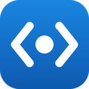
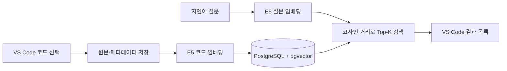

<p align="center">
  
</p>

# dev-memory

**저장해 둔 코드를, 필요한 순간에 자연어로 다시 찾습니다.**

VS Code에서 코드 스니펫을 저장하고 여러 프로젝트의 개인 코드 DB를 검색하는 4인 컴퓨터공학 캡스톤 프로젝트입니다. VS Code 확장 이름은 **Code Memory**입니다.

[시작하기](docs/DEVELOPMENT.md) · [시연 가이드](docs/DEMO.md) · [시스템 구조](docs/ARCHITECTURE.md) · [API 계약](API_CONTRACT.md) · [전체 문서](docs/README.md)

> **현재 단계 · 2026-11-05**<br>
> 저장 → 자동 임베딩 → 의미 검색 → 원본 열기 통합을 `develop`에서 확인했습니다.<br>
> 저장과 검색은 LLM을 호출하지 않습니다. RAG 답변·Ask AI·Token Budget 최적화는 다음 개발 범위입니다.

## 무엇을 할 수 있나요?

| 저장 | 검색 | 다시 사용 |
|---|---|---|
| 선택한 코드와 프로젝트·파일·줄 번호 보관 | 한국어 등 자연어 질문으로 관련 코드 검색 | 원본 파일과 해당 줄로 이동 |
| E5 벡터를 같은 DB 행에 자동 저장 | 코드·위치·유사도를 결과 목록에서 확인 | 코드 복사·삽입·선택 코드와 비교 |
| 원문 저장과 검색 준비 상태를 구분 | 최근 검색·간단히 보기·결과 필터 제공 | 실패한 임베딩은 기존 ID로 재처리 |

프로젝트·언어 필터는 **받아온 검색 결과 안에서** 적용합니다. DB 전체를 조건으로 좁히는 서버 필터는 후속 작업입니다. 원본 열기는 이 PC에 프로젝트와 실제 파일이 있어야 합니다.

## 어떻게 연결되나요?



정상 저장은 원문을 먼저 커밋하고, 벡터와 처리 상태를 같은 행에 기록한 뒤 응답합니다. 임베딩에 실패해도 원문과 ID는 남습니다. 자세한 실패 처리와 데이터 위치는 [시스템 구조](docs/ARCHITECTURE.md)를 참고하세요.

## 시작하기

검증한 개발 구성은 **같은 PC의 Dev Container에서 Backend·DB**, **Windows 로컬 VS Code에서 Extension**입니다.

1. 처음 실행한다면 [개발 가이드](docs/DEVELOPMENT.md)에서 환경·DB 스키마·모델 준비를 확인합니다.
2. [Extension 가이드](extension/README.md)대로 빌드하고 확장 개발 호스트를 엽니다.
3. `codeMemory.mock=false`와 실제 Backend 주소를 확인합니다.
4. [시연 가이드](docs/DEMO.md)대로 저장·검색·원본 열기를 확인합니다.

환경과 DB 준비가 끝났다면 Dev Container의 저장소 루트에서 서버를 실행합니다.

```bash
uv run --locked uvicorn backend.main:app --host 0.0.0.0 --port 8000
```

Windows에서 [서버 상태](http://127.0.0.1:8000/health)와 [API 문서](http://127.0.0.1:8000/docs)를 확인합니다. 포트 전달 주소가 다르면 VS Code **포트** 탭의 주소를 사용합니다. /health 정상 여부와 DB·모델 준비 여부는 별도로 확인합니다.

## 구현 상태와 근거

| 범위 | 상태 | 확인 자료 |
|---|---|---|
| 실제 스니펫 저장·자동 임베딩 | 완료 | [11월 5일 통합 검증](docs/INTEGRATION_TEST_2026-11-05.md) |
| 의미 검색 API·VS Code UI 연결 | 완료 | [10월 28일 기록](docs/INTEGRATION_TEST_2026-10-28.md), [최종 통합 기록](docs/INTEGRATION_TEST_2026-11-05.md) |
| 실패 시 원문 보존·같은 ID 재처리 | 완료 | [재처리 가이드와 검증](rag/README.md) |
| 복사·삽입·원본 이동·빈 결과·검색 오류 표시 | 확인 | [최종 UI 검증](docs/INTEGRATION_TEST_2026-11-05.md) |
| RAG 답변·Ask AI·Context Token Budget | 예정 | [후속 개발 계획](docs/ROADMAP.md) |

기존 CPU·10개 질문 실험에서 E5와 Qwen은 10/10, BGE는 9/10 Hit@1이었습니다. 현재 모델은 해당 조건의 정확도·속도·차원 균형을 근거로 채택한 intfloat/multilingual-e5-base입니다. 작은 표본의 결과이며 모든 코드와 질문에서 우수하다는 의미는 아닙니다. [비교 결과와 원본 산출물](rag/experiments/embedding_compare/comparison_results.md)을 보존합니다.

## 기술과 저장소 구성

| 영역 | 기술 | 위치 |
|---|---|---|
| Extension | TypeScript · VS Code API | [extension/](extension/) |
| Backend | Python · FastAPI | [backend/](backend/) |
| Database | PostgreSQL · pgvector | [database/](database/) |
| Embedding | E5 · Sentence Transformers · CPU · 768차원 | [rag/](rag/) |
| 개발환경 | Docker Compose · Dev Container · uv | [.devcontainer/](.devcontainer/) |
| 검증·문서 | Python unittest · Extension 단위 테스트 · 통합 기록 | [테스트 안내](docs/TESTING.md), [문서 목차](docs/README.md) |

DB 데이터는 각 개발 환경의 Docker volume에 저장됩니다. Git을 내려받는 것만으로 다른 PC의 스니펫 데이터와 원본 파일이 만들어지지는 않습니다.

## 함께 개발하기

담당 브랜치에서 작업하고 **PR base는 develop**으로 설정합니다. main은 발표·안정 버전용입니다. 최신 개발 문서를 찾을 때는 [develop](https://github.com/GlancingMonkey/dev-memory-/tree/develop)을 확인하세요.

- [역할 분담·Git 작업 규칙](PROJECT_GUIDE.md)
- [공식 요청·응답 계약](API_CONTRACT.md)
- [다음 개발의 우선순위와 완료 기준](docs/ROADMAP.md)

라이선스: [MIT](LICENSE).
