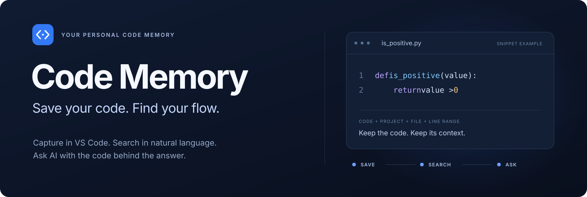
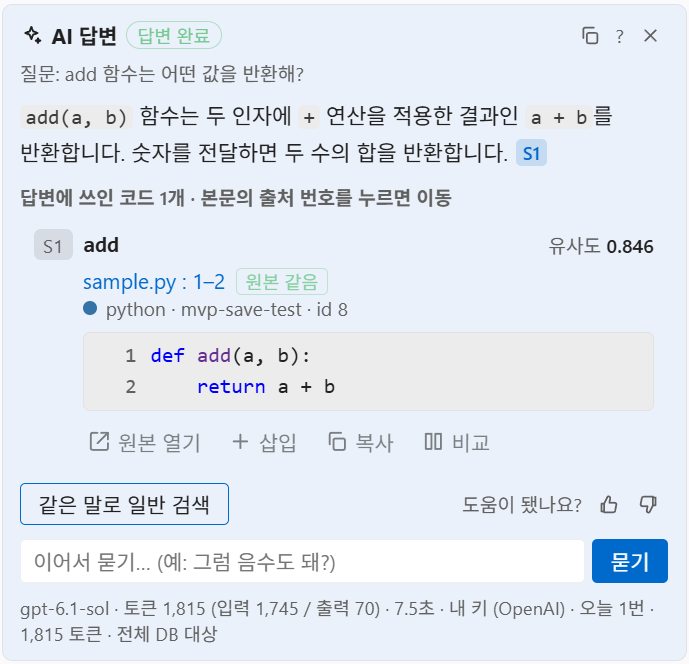
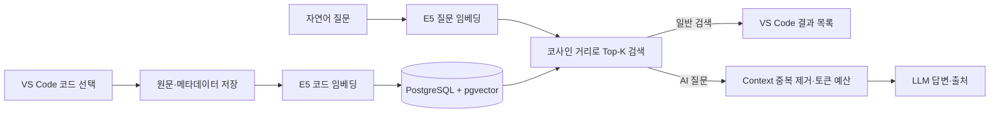

<p align="center">
  
</p>

<p align="center">
  <strong>저장한 코드가, 다음 작업의 출발점이 됩니다.</strong><br>
  VS Code에서 코드를 저장하고, 말로 검색하고, 필요한 순간에만 AI에게 물어보세요.
</p>

<p align="center">
  <a href="#시작하기">시작하기</a> ·
  <a href="docs/USER_GUIDE.md">사진으로 따라 하기</a> ·
  <a href="docs/README.md">문서</a> ·
  <a href="CHANGELOG.md">릴리스 노트</a> ·
  <a href="https://github.com/GlancingMonkey/dev-memory-/issues">피드백</a>
</p>

**Code Memory**는 여러 프로젝트에 흩어진 코드 조각을 모아 두고 다시 찾아 쓰는 VS Code 확장입니다. 저장소 이름은 `dev-memory-`이며, 현재는 소스에서 빌드해 사용하는 로컬 개발 구성으로 제공합니다. `main`은 검증한 통합 버전, `develop`은 다음 변경을 모으는 브랜치입니다.

## 기억해 두고, 다시 찾아 쓰세요

| 저장 | 검색 | AI에게 질문 |
|---|---|---|
| 필요한 코드를 선택하고 저장합니다. | “0으로 나누는 경우를 처리하는 함수”처럼 말로 찾습니다. | “이 함수에 0을 넣으면?”처럼 동작을 묻습니다. |
| 원문과 프로젝트·파일·줄 번호를 보관하고 E5 벡터를 만듭니다. | 관련 코드와 위치를 확인하고 바로 복사·삽입합니다. | 찾은 코드로 답변을 만들고, 출처에서 근거를 확인합니다. |
| 임베딩에 실패해도 원문과 저장 ID를 유지합니다. | **일반 검색에는 LLM을 호출하지 않습니다.** | **사용자가 AI 질문을 실행할 때 LLM을 호출합니다.** |

검색 대상은 **직접 저장한 코드**입니다. Extension은 이 PC에서 연결한 프로젝트 위치를 기억하므로, 다른 프로젝트를 작업하면서도 원본 파일을 바로 열 수 있습니다. 처음 보는 위치는 한 번 연결하며, 실제 파일은 PC에 있어야 합니다.

## 실제 Extension 화면

<table>
  <tr>
    <td width="54%" valign="top">
      <h3>답변에서 코드까지, 한곳에서.</h3>
      <p>AI 답변의 출처 번호를 누르면 해당 참고 코드로 이동합니다. 파일 위치와 줄 번호를 확인하고 원본을 열거나 코드를 다시 사용할 수 있습니다.</p>
      <p><strong>검색 범위</strong><br>일반 검색은 프로젝트·언어로 좁힐 수 있습니다.</p>
      <p><strong>원본 확인</strong><br>저장한 코드와 지금 파일의 내용·위치가 달라졌는지 표시하고 비교합니다.</p>
      <p><strong>개인 AI 키</strong><br>OpenAI·Claude·Gemini 키를 VS Code 비밀 저장소에 보관하고 AI 질문에 사용합니다.</p>
      <p><a href="docs/USER_GUIDE.md">실제 화면으로 한 단계씩 따라 하기 →</a></p>
    </td>
    <td align="center" valign="top">
      <a href="docs/USER_GUIDE.md#8-ai에게-묻고-출처-확인하기"></a>
    </td>
  </tr>
</table>

화면은 사용자가 2026년 11월 22일 Windows VS Code의 밝은 테마에서 직접 촬영한 OpenAI 답변입니다. [사진 가이드](docs/USER_GUIDE.md)에 저장부터 출처 확인까지 실제 화면 8장을 담았습니다. 표시된 시간·토큰은 해당 화면의 관측값이며, 현재 AI 질문은 일반 검색의 필터와 별도로 **전체 DB**를 대상으로 합니다.

## 시작하기

검증한 구성은 **Windows 로컬 VS Code의 Extension + 같은 PC의 Dev Container에 실행한 Backend·PostgreSQL**입니다. 임베딩은 CPU에서 실행합니다.

| 순서 | 안내 |
|---|---|
| 1. 환경 준비 | [개발 가이드](docs/DEVELOPMENT.md)에서 Docker·Dev Container·DB 스키마·모델 준비 |
| 2. Extension 실행 | [빌드와 확장 개발 호스트 열기](extension/README.md#빌드) |
| 3. 실제 서버 연결 | [설정](extension/README.md#실제-api-설정)에서 `codeMemory.mock=false`와 Backend 주소 확인 |
| 4. 첫 코드 저장·검색 | [사진으로 따라 하기](docs/USER_GUIDE.md)의 저장 → 검색 → 원본 열기 → AI 질문 순서 실행 |

환경과 DB 준비가 끝났다면 **Dev Container의 저장소 루트**에서 서버를 실행합니다.

```bash
uv run --locked uvicorn backend.main:app --host 0.0.0.0 --port 8000
```

Windows에서 [서버 상태](http://127.0.0.1:8000/health)와 [API 문서](http://127.0.0.1:8000/docs)를 확인합니다. 포트 전달 주소가 다르면 VS Code **포트** 탭의 주소를 사용하세요. `/health`는 서버 실행 여부를 확인하며, DB·모델 준비 여부는 별도로 확인합니다.

AI 답변을 사용할 때는 [개인 키·서버 기본 키 안내](docs/PERSONAL_LLM_KEYS.md)를 따릅니다. 세 제공자의 연결 구현과 실제로 확인한 범위는 해당 가이드와 날짜별 검증 기록에서 구분합니다.

## 작동 방식



정상 저장은 원문을 먼저 커밋하고, 같은 행에 벡터와 처리 상태를 기록한 뒤 응답합니다. 임베딩 실패 시 원문을 보존하며, 기존 ID로 재처리할 수 있습니다. [시스템 구조](docs/ARCHITECTURE.md)와 [공식 API 계약](API_CONTRACT.md)에 처리 순서·오류 규칙을 정리했습니다.

| 영역 | 구성 |
|---|---|
| Extension | TypeScript · VS Code API |
| Backend | Python · FastAPI |
| 검색 | PostgreSQL · pgvector · 코사인 거리 |
| Embedding | `intfloat/multilingual-e5-base` · 정규화한 768차원 벡터 |
| AI 질문 | 검색한 코드 · Context 중복 제거 · 토큰 예산 · 출처 표시 |
| 개발환경 | Docker Compose · Dev Container · uv |

## 확인 가능한 검증 기록

구현 상태와 함께 **어떻게 확인했는지**를 공개합니다.

| 확인 내용 | 기록 |
|---|---|
| main 통합 전 Python 103개·Extension 87개 검사, TypeScript·ESLint | [통합 PR #63](https://github.com/GlancingMonkey/dev-memory-/pull/63), [테스트 안내](docs/TESTING.md) |
| 실제 API·DB 검색, 원본 이동·필터·오류 복구와 저장·키 UI | [11월 21일](docs/INTEGRATION_TEST_2026-11-21.md), [11월 22일](docs/INTEGRATION_TEST_2026-11-22.md) |
| 25개 질문의 Context 비교, 기존 답변 50건의 작성자 본인 검토 | [평가 조건·결과·한계](docs/EVALUATION_2026-11-16.md) |
| CPU·10개 질문의 Embedding 세 모델 비교 | [비교 결과와 원본 산출물](rag/experiments/embedding_compare/comparison_results.md) |

작은 내부 평가와 작성자 검토는 독립 평가나 모든 코드에서의 정확도 보장이 아닙니다. 실제 제공자 호출, 모의 UI 응답, 기존 결과 검토를 구분해 기록합니다. E5 채택 근거도 당시 샘플·CPU 조건의 정확도·속도·차원 균형입니다.

## 데이터와 키

- 코드와 메타데이터·벡터는 연결한 PostgreSQL에 저장합니다. Git을 내려받는 것만으로 다른 PC의 DB 데이터와 원본 파일이 만들어지지는 않습니다.
- 개인 API 키는 VS Code **SecretStorage**에 보관하며, 검색·저장 요청에는 포함하지 않습니다. AI 질문에만 선택한 키를 전달합니다.
- AI 질문 시 질문과 참고 코드가 선택한 LLM 제공자로 전달됩니다. 키 선택·전송 조건은 [개인 AI 키 안내](docs/PERSONAL_LLM_KEYS.md)를 확인하세요.

## 함께 만들기

**Hazard & Stalls**의 4인 컴퓨터공학 캡스톤 프로젝트입니다. 사용 중 발견한 문제나 제안은 [Issues](https://github.com/GlancingMonkey/dev-memory-/issues)로 남겨 주세요.

[기여 안내](CONTRIBUTING.md) · [팀 개발 규칙](PROJECT_GUIDE.md) · [전체 문서](docs/README.md) · [릴리스 노트](CHANGELOG.md) · [후속 계획](docs/ROADMAP.md)

| Extension | Backend | Database | RAG · Backend 지원 |
|---|---|---|---|
| [applecider2](https://github.com/applecider2) | [wanghaiwen05-ui](https://github.com/wanghaiwen05-ui) | [JeongSeungwan](https://github.com/JeongSeungwan) | [GlancingMonkey](https://github.com/GlancingMonkey) |

[MIT License](LICENSE) · © 2026 Hazard & Stalls
