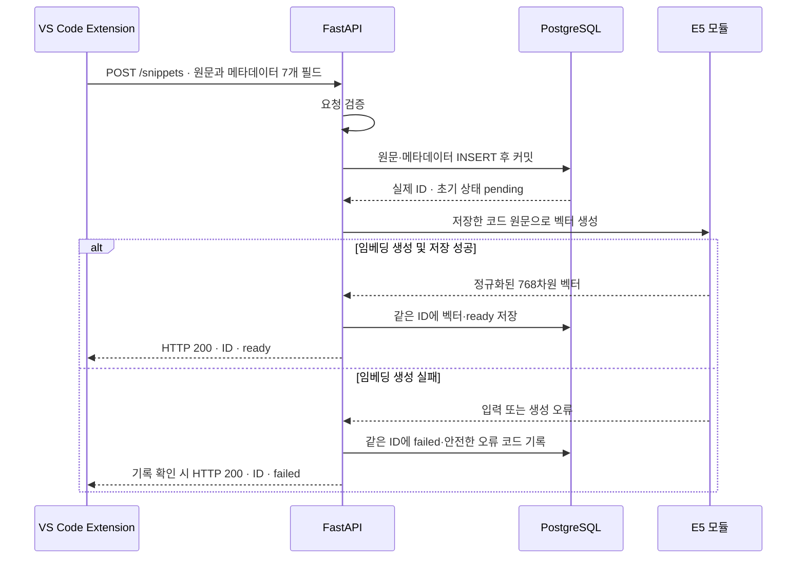
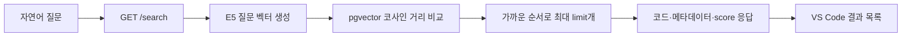

# 시스템 구조

dev-memory는 **코드 원문을 보관하는 DB**와 **의미가 가까운 코드를 찾는 벡터 검색**을 연결한다.
Extension은 사용자 입력과 결과 표시를 맡고, Backend가 DB와 임베딩 모듈을 연결한다.
현재 저장·검색에는 LLM을 호출하지 않는다. RAG 답변과 Context Token Budget은 후속 개발 범위다.

실행 순서는 [개발 가이드](DEVELOPMENT.md), 요청·응답의 공식 기준은 [API 계약](../API_CONTRACT.md)을 따른다.

## 구성 요소

| 구성 | 맡은 일 | 구현 위치 |
|---|---|---|
| VS Code Extension | 코드 선택, 메타데이터 수집, 저장·검색 요청, 결과 활용 | [extension/src](../extension/src) |
| FastAPI Backend | 요청 검증, 원문 저장, 임베딩 호출, 검색 결과 응답 | [backend](../backend) |
| E5 임베딩 모듈 | 코드·질문을 정규화된 768차원 벡터로 변환 | [rag/embedding.py](../rag/embedding.py) |
| PostgreSQL + pgvector | 원문·메타데이터·벡터·상태 보관, 코사인 거리 검색 | [database/init.sql](../database/init.sql), [backend/database.py](../backend/database.py) |

현재 개발 환경에서는 Backend와 DB를 Dev Container·Docker에서, Extension을 Windows 로컬 VS Code에서 실행한다.
Extension의 API 주소와 Backend의 DB 연결 주소는 서로 다른 설정이다.

## 1. 저장: 원문 보존 후 검색 준비

정상 저장 요청은 벡터 저장까지 기다린다. 모델 처리는 원문 저장 트랜잭션 밖에서 수행한다.
따라서 임베딩이 실패해도 먼저 커밋한 원문·메타데이터·ID는 보존된다.
벡터 저장 실패와 최종 상태 확인 불가 등의 상세 분기는 [POST /snippets 계약](../API_CONTRACT.md)에 정의돼 있다.

응답 시간 초과만으로 저장 실패를 판단할 수는 없다. 같은 POST를 다시 보내기 전에 서버 로그와 DB를 확인한다.
현재 같은 코드를 다시 저장하면 새 ID가 생기며, 중복 저장을 자동으로 합치는 기능은 없다.

구현: [저장 라우터](../backend/routers/snippets.py), [DB 저장·갱신 함수](../backend/database.py).

## 2. 검색: 질문과 저장된 코드의 벡터 비교

- 코드에는 `passage: `, 질문에는 `query: ` 접두사를 모듈이 붙인다. 호출자는 원문을 전달한다.
- 검색 대상은 **벡터가 NULL이 아니고 norm이 0보다 큰 행**이다. 현재 SQL은 상태 이름만으로 대상을 고르지 않는다.
- 코사인 거리가 작은 순서로 정렬하며, 거리가 같으면 ID가 작은 행부터 반환한다.
- `score = 1 - cosine_distance`이며 범위는 -1~1이다. 점수는 정답 확률이 아니다.
- 기본 limit은 10, 허용 범위는 1~20이다. 결과가 없으면 빈 배열을 반환한다.
- 관련 없는 질문도 가까운 후보를 반환할 수 있다. 관련성 기준점과 결과 중복 제거는 아직 적용하지 않는다.
- 프로젝트·언어 필터는 현재 Extension이 받은 결과에 적용한다. Backend 검색 조건 필터는 후속 작업이다.

구현: [검색 라우터](../backend/routers/search.py), [검색 SQL](../backend/database.py), [검색 UI](../extension/src/sidebar.ts).

## 3. 처리 상태와 실패 복구

| DB 상태 | 의미 |
|---|---|
| `pending` | 원문은 있고 임베딩이 미처리된 상태. 백그라운드 실행 중이라는 뜻은 아님 |
| `ready` | 해당 코드의 벡터 저장 완료 |
| `failed` | 임베딩 처리 실패. 원문과 ID를 유지하고 실패 사유 기록 |

API의 `embedding_status: null`은 **원문 저장은 확인됐지만 최종 상태를 확인하지 못했다는 응답**이다.
DB에 `null`이라는 새 상태를 추가하는 의미가 아니다. Extension도 저장된 ID와 검색 준비 확인 필요를 구분해 표시한다.
원문 저장 자체를 확인하지 못한 응답이나 통신 실패 역시 자동 재전송하지 않는다.

재처리 CLI는 프로젝트와 ID를 함께 확인하며, 기본 실행은 읽기 전용이다.
`--apply`를 지정하면 읽은 원문으로 벡터를 만들고 **같은 행**을 갱신한다.
갱신 조건에는 ID·프로젝트·원문 일치, 벡터 NULL, `pending` 또는 `failed` 상태가 포함된다.
이미 벡터가 있으면 건너뛰고, 입력 한도 오류도 같은 입력으로 반복 처리하지 않는다.
성공하면 `ready`로 바꾸고 실패 사유를 지운다. 자세한 사용법은 [RAG 재처리 안내](../rag/README.md)에 있다.

## 4. 데이터는 어디에 남는가

| 데이터 | 저장 위치와 의미 |
|---|---|
| 스니펫 원문·메타데이터·벡터·처리 상태 | PostgreSQL의 `snippets` 행. Compose의 `postgres_data` volume에 유지 |
| 원본 소스 파일 | 사용자가 연 로컬 프로젝트. DB의 `file_path`는 프로젝트 기준 상대 경로 |
| Extension 저장 기록·화면 설정 | VS Code의 해당 workspace 상태. DB 전체 목록이나 실시간 상태 조회가 아님 |
| 프로그램 코드·문서·실험 산출물 | Git 저장소. 다른 PC의 실제 DB 행과 로컬 원본 파일은 포함하지 않음 |

원본 열기는 로컬 파일을 찾아 이동하는 기능이다. Git을 내려받거나 DB 검색에 성공해도 다른 PC의 원본 파일이 자동으로 생기지는 않는다.
재처리로 DB 상태를 바꿔도 과거 Extension 저장 기록이 자동으로 최신화되는 것으로 해석하지 않는다.

근거: [Compose volume](../docker-compose.yml), [workspace 상태 연결](../extension/src/extension.ts), [저장 기록 관리](../extension/src/sidebar.ts).

## 현재 경계

- E5 입력 한도는 접두사·특수 토큰을 포함해 512토큰이다. 긴 코드의 자동 분할은 아직 구현하지 않았다.
- `/health`는 서버 실행 확인용이다. DB 연결이나 모델 준비 성공까지 보장하지 않는다.
- 서버 시작 시 E5 warmup을 시도하며, 실패해도 서버 자체는 실행될 수 있다.
- 현재 DB 스키마에는 프로젝트·언어 인덱스가 있다. 별도의 벡터 검색 인덱스는 아직 추가하지 않았다.
- 후속 RAG는 검색한 코드를 답변의 참고 자료로 사용하는 단계다. 현재 검색 경로에 LLM이 연결된 것은 아니다.
