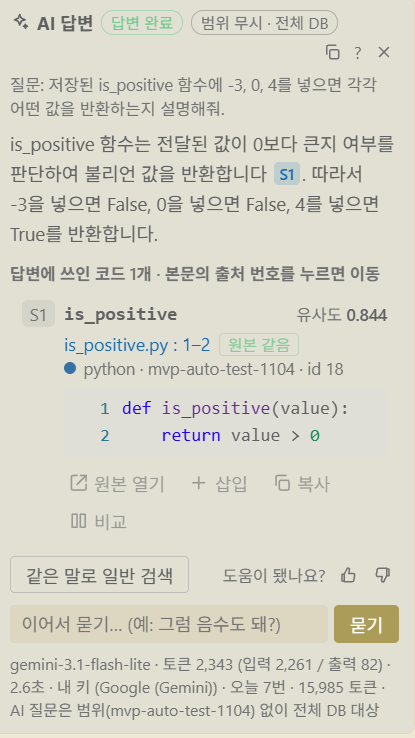

# 2026-11-18 통합 검증 기록

**Windows Extension에서 새 코드를 저장하고, 자동 임베딩·일반 검색·프로젝트 필터·원본 이동·Gemini 답변까지 확인했다.** OpenAI는 실제 API와 화면을 대조했고, Claude는 Extension 담당자의 실제 연결 성공을 사용자에게 전달받았다.

이 문서는 연결 확인 결과다. 기존 모델 비교나 25개 질문 품질 평가를 다시 실행한 결과가 아니다.

## 기준과 근거

| 항목 | 확인 범위 |
|---|---|
| 코드 기준 | develop `c534e1d236451a6f48232ddc1664c74bbf93f4e7` |
| 관련 병합 | Backend 개인 키 #54 → Extension #53 → 출처 안내 수정 #55 |
| 실행 환경 | Dev Container Backend·PostgreSQL/E5 CPU, Windows 확장 개발 호스트, 실제 서버 모드 |
| 실제 API | 로컬 HTTP 응답·DB 읽기 전용 조회로 직접 대조 |
| 실제 화면 | 사용자 스크린샷과 직접 조작 결과로 확인 |
| 구조화 기록 | [검증 데이터](validation/2026-11-18-integration.json) |

초기 OpenAI HTTP 검사는 `2980221`에서 실행했다. 이후 #55는 Extension 안내 문구 한 줄만 바꿨으며, 최종 저장·검색·Gemini 화면은 `c534e1d`에서 확인했다. Claude의 모델명·usage·응답 원본·근거 부족 결과는 별도로 받지 않았다.

## 새 스니펫으로 전체 흐름 확인

시험 프로젝트: `mvp-auto-test-1104`, 새 파일: `is_positive.py`.

```python
def is_positive(value):
    return value > 0
```

| 단계 | 실제 결과 |
|---|---|
| Extension 저장 | 7개 필드 전송, HTTP 200, 실제 ID 18, ready, embedding_error=null. 화면 로그 0.35초 |
| DB 대조 | CRLF·들여쓰기 포함 코드와 메타데이터 일치, 같은 행의 768차원 벡터·norm 약 1 확인 |
| 일반 검색 | “숫자가 0보다 큰 양수인지 확인하는 함수”, limit=10, ID 18이 2위. API와 화면 일치 |
| 프로젝트 필터 | `mvp-auto-test-1104` 선택 시 ID 18·6·8 순서의 3개 결과, ID 18이 1위. 범위 적용 표시 확인 |
| 원본 이동 | 사용자가 `is_positive.py: 1–2`를 눌러 편집기로 이동했다고 확인 |
| 새 코드 AI 질문 | -3→False, 0→False, 4→True 답변. S1 → 실제 ID 18·원문·경로·1~2줄 출처 확인 |
| AI 검색 범위 | 프로젝트 필터가 켜져 있어도 전체 DB 대상이라는 현재 계약을 화면에 명시 |

최종 답변 모델은 `gemini-3.1-flash-lite`, 개인 Google(Gemini) 키 모드였다. 화면 표시 usage는 입력 2,261·출력 82·합계 2,343토큰, 시간은 2.6초다. 원본 `/ask` 헤더·응답은 수집하지 않았으며 화면 관측값으로 기록한다.

<details>
<summary>새 스니펫을 근거로 답한 실제 Gemini 화면</summary>



</details>

일반 검색 1위는 `buildAskRequest`였고, 기대한 `is_positive`는 2위였다. **저장·검색 연결 성공과 검색 순위 품질은 구분한다.** 이 사례를 기존 25개 평가의 분모에 추가하거나 Hit@1 성공으로 기록하지 않았다.

## 필터와 DB 보존

같은 질문의 limit=1 API에서 무필터는 ID 17, project=`mvp-auto-test-1104`·language=`python` 조건은 ID 18을 반환했다. 전역 Top-1에 없는 코드도 조건 검색의 Top-1로 반환되는 사례를 대조했다.

최종 DB는 기존 17행에 시험 행 ID 18 하나를 추가한 18행이다. 유효한 벡터가 있는 행은 17개다. 기존 17개 행의 원문·메타데이터·벡터·처리 상태·생성/수정 시각은 최초 스냅샷과 동일하다. 기존 실패 행도 보존했다.

| GET /filters | 실제 name/count |
|---|---|
| projects | backend-api-regression: 1, capstone-rag: 9, mvp-auto-test-1104: 3, mvp-save-test: 4 |
| languages | python: 11, typescript: 6 |

count는 NULL·영벡터를 제외한 **행 수**다. ID 6·8의 같은 safe_divide도 두 행으로 센다. 일반 검색의 중복 행 표시와 AI Context의 중복 제거는 서로 다른 처리다.

## 제공자별 확인

| 제공자 | 직접 확인한 범위 | 근거 |
|---|---|---|
| OpenAI | 개인 키 JSON 정상·SSE 근거 부족, 서버 기본 키 SSE 정상, history 1턴 후속 질문, 실제 잘못된 키 401. 출처/DB·SSE delta/최종 답변 대조 | 실제 HTTP 원본 4건과 인증 오류, 사용자 화면 |
| Gemini | 개인 키 변경 후 정상 질문 성공, JWT 근거 부족·출처 없음, ID 18을 인용한 새 코드 설명 | 정상 질문은 사용자 확인, JWT와 ID 18은 실제 화면 |
| Claude | 담당자가 실제 연결에 성공 | Extension 담당자의 성공 확인을 사용자에게 전달받음. 상세 자료 미제공 |

OpenAI HTTP 4건의 실제 반환 usage 합계는 입력 8,478·출력 336·합계 8,814토큰이다. 화면에서 추가 실행한 요청과 합산한 전체 사용량이 아니다. 상세 응답은 검증 데이터에 보존했다.

Gemini JWT 화면은 입력 2,584·출력 48·합계 2,632토큰, 17.7초였다. 다른 질문의 2.6초와 동일 조건 성능 비교를 하지 않는다. Claude/Gemini는 현재 생성 완료 후 기존 SSE 형식의 delta/done으로 전달하며, 제공자 토큰 단위 스트리밍 검증으로 표현하지 않는다.

개인 키는 사용자가 Extension SecretStorage에 직접 등록했다. 현재 개인 등록은 한 개이므로 OpenAI→Gemini 변경 시 이전 개인 등록값이 교체된다. 서버 기본 키와는 별도다. 키 값·인증 헤더는 검증 문서에 포함하지 않는다.

## 후속 질문과 출처 안내 수정

사용자가 OpenAI에서 “그럼 b가 0이면 예외를 발생시키는 거야?”를 후속 질문했다. 이전 대화 1개를 사용해 None을 반환한다고 답했고, S2 → safe_divide/ID 6 출처를 확인했다. S2 클릭 시 해당 카드의 일시적 강조도 확인했다.

이때 실제 인용이 S2인데 안내문은 S1로 고정되는 표시 오류를 발견했다. #55에서 **“본문의 출처 번호를 누르면 이동”**으로 수정했다. Extension 72개 검사·TypeScript·ESLint·빌드·공백 검사가 통과했고, 사용자가 다시 로드한 화면의 수정 문구를 확인했다.

Backend 103개 자동 검사의 기존 근거는 [키 계약 검증](VALIDATION_2026-11-18_KEYS.md)에 있다. 이번 문서 정리에서는 Backend 검사·Embedding 비교·25개 품질 평가를 반복하지 않았다.

## 재현과 인수인계

1. [실행 가이드](DEVELOPMENT.md)로 DB·Backend와 실제 서버 모드 Extension을 준비한다.
2. 시험 파일을 저장·선택해 POST 결과의 실제 ID와 ready를 확인한다. 시간 초과 시 같은 저장을 반복하기 전에 DB 상태를 확인한다.
3. DB의 코드·7개 필드·벡터와 일반 검색 결과를 대조하고 프로젝트/언어 조건을 시험한다.
4. 현재 파일의 원본 이동과, 명시적 AI 질문의 답변·출처·모델·실제 usage·근거 부족을 확인한다.
5. 다른 PC에서는 이 기록의 ID·DB volume·원본 파일이 자동으로 공유된다고 가정하지 않는다. 해당 환경의 실제 ID를 사용한다.

| 담당 | 남은 확인 |
|---|---|
| Backend · wanghaiwen05-ui | 계약·실행·안전한 오류 처리 인수인계, 제공자 권한/할당량 오류의 실제 사례가 있으면 기록 |
| RAG · GlancingMonkey | 기존 25개 평가의 답변·수치·한계를 팀원과 교차 검토. 이번 새 코드의 2위 사례를 별도로 보존 |
| Database · JeongSeungwan | 최종 DB/조건/count와 기존 자료 보존 결과 검토. 다른 PC를 쓸 경우 별도 준비 |
| Extension · applecider2 | 언어/조건 조합·해제/빈 결과·늦은 응답, 취소·오류 복구·복사/삽입·비교·키 삭제/서버 키 수동 전환·평가 화면의 남은 항목, Claude 상세 결과 |
| 팀 공통 | 실제 수행한 항목만 이슈에 체크하고 시연·포스터 자료를 검토. 독립 사용자 평가와 팀 내부 확인 구분 |

포스터의 품질·토큰 전후 비교에는 [11/16 평가와 한계](EVALUATION_2026-11-16.md)를 사용한다. 이번 소수 연결 사례로 모델 우위·일반 정확도·속도 향상을 주장하지 않는다.

[문서 목차](README.md) · [API 계약](../API_CONTRACT.md) · [사용자 키 연결](PERSONAL_LLM_KEYS.md)
