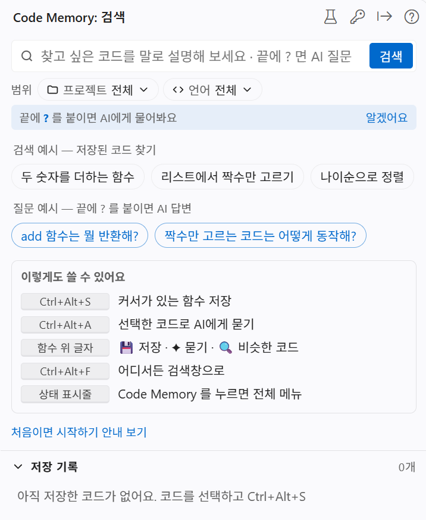
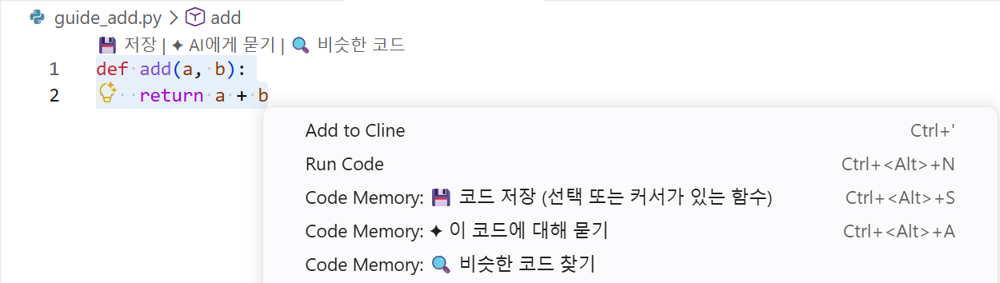
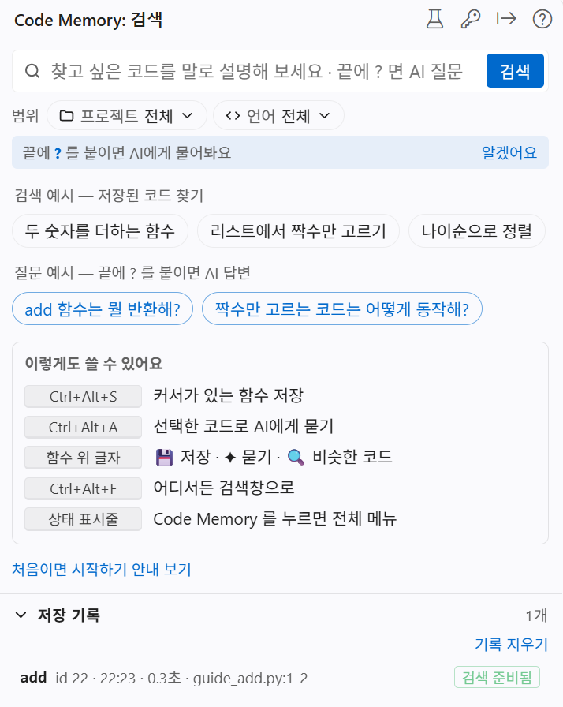
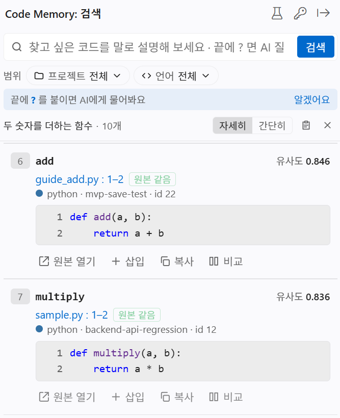
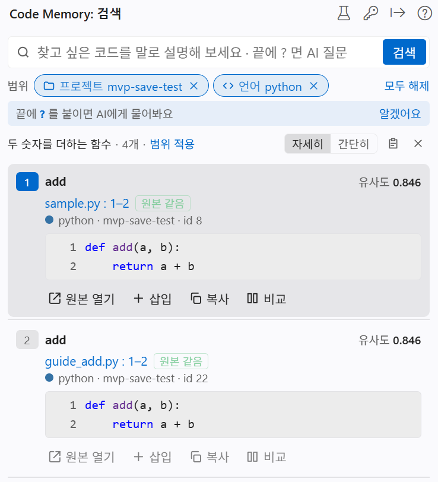
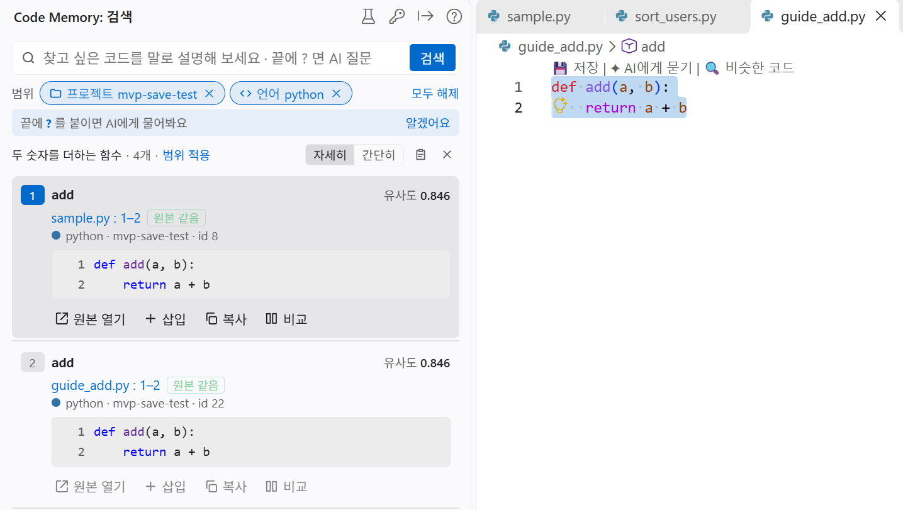
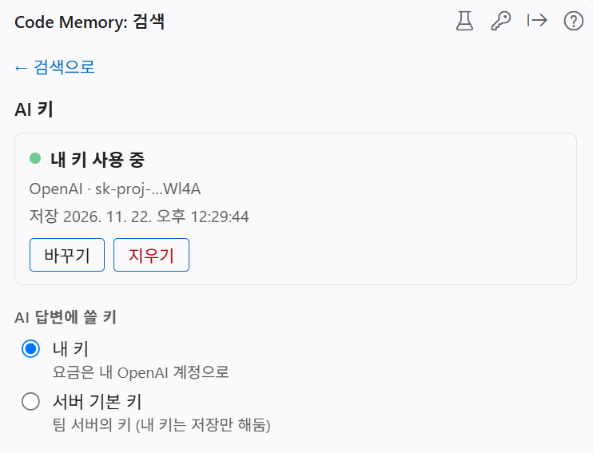
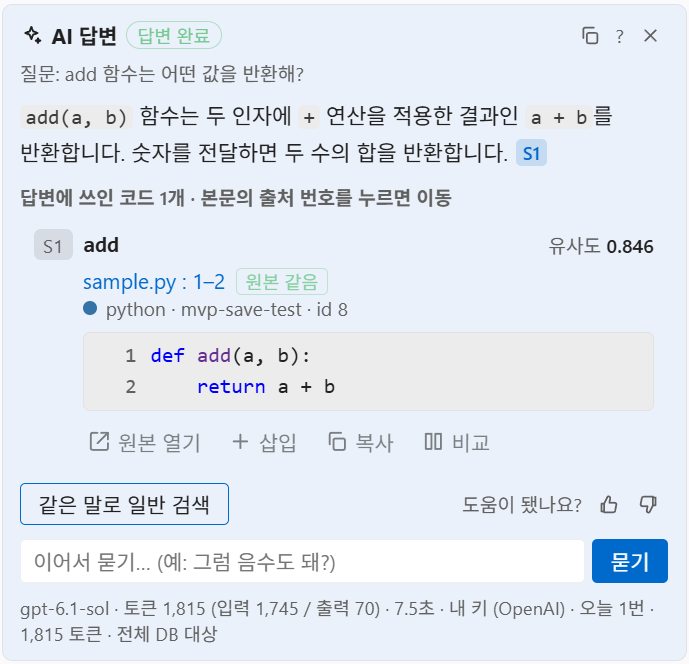

# Code Memory 사용 가이드

**코드를 저장하고, 말로 찾고, 출처를 확인하며 다시 사용해 보세요.**

각 단계의 설명 바로 아래에 실제 화면을 배치했습니다. 사진은 2026년 11월 22일 Windows VS Code의 밝은 테마에서 사용자가 직접 촬영한 화면입니다. 사진을 누르면 원본 크기로 볼 수 있습니다.

[검색창 열기](#1-검색창-열기) · [코드 저장](#2-코드-선택하고-저장하기) · [자연어 검색](#4-말로-코드-찾기) · [범위 선택](#5-프로젝트와-언어로-범위-좁히기) · [AI 질문](#8-ai에게-묻고-출처-확인하기)

## 시작 전

Backend·DB와 Extension이 실행된 환경에서 따라 합니다. 처음 설치한다면 [개발환경 준비](DEVELOPMENT.md)와 [Extension 실행](../extension/README.md#빌드)을 먼저 확인하세요. 실제 저장·검색은 `codeMemory.mock=false`와 연결할 Backend 주소를 설정합니다.

사진의 `mvp-save-test`, `guide_add.py`, ID는 촬영에 사용한 예시입니다. 본인의 프로젝트와 코드로 따라 해도 되며, 저장 ID·검색 개수·순위는 환경마다 달라집니다.

## 1. 검색창 열기

VS Code에서 프로젝트 폴더를 열고 **Ctrl+Alt+F**를 누릅니다. 명령 팔레트의 **Code Memory: 검색창 열기**로도 열 수 있습니다.

아래처럼 Code Memory 패널이 보이면 준비됐습니다. 맨 위 입력창이 코드를 찾고 AI에게 질문하는 곳입니다. VS Code 설정 검색창과 구분하세요.

<p><a href="images/guide/01-start-light.png"></a></p>

## 2. 코드 선택하고 저장하기

프로젝트 안에 예제용 `guide_add.py` 파일을 새로 만들고 저장합니다. 같은 이름의 파일이 있다면 내용을 먼저 확인하고 다른 예제 파일 이름을 사용하세요.

```python
def add(a, b):
    return a + b
```

두 줄을 선택한 뒤 마우스 오른쪽 버튼을 눌러 **Code Memory: 💾 코드 저장**을 선택합니다. **Ctrl+Alt+S**로도 저장할 수 있습니다.

<p><a href="images/guide/02-save-menu-light.png"></a></p>

이미 비슷한 코드가 있다면 중복 안내가 나올 수 있습니다. 새 저장본을 남길 때는 **그래도 저장**, 기존 코드를 확인할 때는 **기존 것 보기**를 선택합니다.

## 3. 저장 완료 확인하기

Code Memory 패널 아래의 **저장 기록**을 펼칩니다. 방금 저장한 함수·파일과 **검색 준비됨** 표시를 확인하세요.

사진에서는 `guide_add.py`의 `add`가 ID 22로 저장됐습니다. 이 숫자는 촬영 환경에서 생성한 ID이며, 새로 저장하면 다른 ID가 나올 수 있습니다.

<p><a href="images/guide/03-saved-light.png"></a></p>

**검색 준비 실패**는 원문은 저장됐지만 검색에 필요한 임베딩 처리가 실패했다는 뜻입니다. 저장 여부가 불확실하거나 시간 초과가 나오면 같은 저장을 반복하기 전에 [오류 안내](DEVELOPMENT.md#8-종료와-오류-확인)를 확인하세요.

## 4. 말로 코드 찾기

맨 위 Code Memory 검색창에 다음과 같이 입력하고 **검색** 버튼을 누릅니다.

```text
두 숫자를 더하는 함수
```

일반 검색은 LLM을 호출하지 않습니다. 결과에서 함수 이름, 파일·줄 번호와 코드 원문을 확인하세요.

<p><a href="images/guide/04-search-light.png"></a></p>

이 사진의 `guide_add.py`는 6위입니다. 같은 내용의 코드가 여러 개 저장되어 있어도 각각 결과에 나타날 수 있습니다. **방금 저장한 코드가 항상 1위일 필요는 없습니다.** 파일명과 저장 ID도 함께 확인하세요. 유사도는 정확도 퍼센트가 아닙니다.

## 5. 프로젝트와 언어로 범위 좁히기

결과가 많으면 검색창 아래 **프로젝트 전체**와 **언어 전체**를 눌러 원하는 범위를 선택합니다. 사진에서는 프로젝트 `mvp-save-test`, 언어 `python`을 선택했습니다.

선택한 범위와 **범위 적용** 표시를 확인하세요. **모두 해제**를 누르면 전체 범위로 돌아갑니다.

<p><a href="images/guide/05-filters-light.png"></a></p>

촬영 환경에서는 전체 검색에서 6위였던 같은 ID 22가 범위를 좁힌 뒤 2위에 나타났습니다. 검색 대상이 달라지면 개수와 순위도 달라집니다.

## 6. 원본 열고 코드 다시 사용하기

원하는 결과 카드의 **원본 열기** 또는 파일·줄 번호 링크를 누릅니다. 사진에서는 검색한 `guide_add.py`가 편집기에 열리고 저장한 두 줄로 이동했습니다.

<p><a href="images/guide/06-open-source-light.png"></a></p>

| 버튼 | 사용하는 방법 |
|---|---|
| 원본 열기 | 코드가 저장된 실제 파일과 해당 위치로 이동합니다. |
| 복사 | 저장된 코드를 복사해 원하는 곳에 붙여넣습니다. |
| 삽입 | 현재 편집기의 커서 위치에 저장된 코드를 넣습니다. |
| 비교 | 편집기에서 선택한 코드와 저장된 코드를 비교합니다. |

처음 보는 프로젝트는 **원본 위치 연결**로 이 PC의 폴더를 한 번 지정합니다. 이후에는 해당 프로젝트를 작업 영역에 다시 추가하지 않아도 원본 파일을 열 수 있습니다. 실제 파일이 없는 PC에서도 저장된 코드를 복사해 사용할 수 있습니다.

## 7. AI 답변에 사용할 키 선택하기

패널 제목줄의 **열쇠 아이콘**으로 AI 키 화면을 엽니다. 개인 키를 사용할 때는 제공자를 선택해 키를 저장하고 **내 키**를 선택합니다. OpenAI·Claude·Gemini를 지원합니다.

아래처럼 **내 키 사용 중**이 표시되면 개인 키가 선택된 상태입니다. **서버 기본 키**를 선택하면 서버에 설정된 키를 사용합니다.

<p><a href="images/guide/07-ai-key-light.png"></a></p>

키는 VS Code 비밀 저장소에 보관합니다. 개인 키를 선택한 AI 질문에는 해당 키를 전달하며, 일반 검색·저장 요청에는 포함하지 않습니다. 자세한 등록·전송 조건은 [개인 AI 키 안내](PERSONAL_LLM_KEYS.md)를 따르세요.

## 8. AI에게 묻고 출처 확인하기

**← 검색으로** 돌아가 다음 질문을 입력하고 **Ctrl+Enter**를 누릅니다.

```text
add 함수는 어떤 값을 반환해?
```

기본 설정에서는 끝에 `?`를 붙이고 Enter를 눌러도 AI에게 질문합니다. Ctrl+Enter는 물음표 설정과 관계없이 AI 질문을 실행합니다.

답변이 완료되면 **답변 본문의 S1 같은 출처 번호**를 눌러 참고 코드로 이동합니다. 해당 카드의 코드와 파일 위치를 확인하고, 필요하면 원본을 열거나 복사합니다.

<p><a href="images/guide/08-ai-answer-light.png"></a></p>

사진의 답변은 같은 내용을 가진 기존 `sample.py`(ID 8)를 참고했습니다. AI는 질문과 관련된 저장 코드를 다시 검색하므로, 직전 일반 검색에서 고른 ID 22와 출처 ID가 다를 수 있습니다.

현재 AI 질문은 일반 검색의 프로젝트·언어 필터와 별도로 **전체 DB**를 대상으로 하며, 답변 아래에도 이 범위를 표시합니다. 저장된 코드만으로 답할 근거가 부족하면 **근거 부족**을 안내합니다. 이어서 질문하려면 답변 아래 **이어서 묻기**를 사용하세요.

## 막히면 확인할 것

| 화면에 보이는 상태 | 확인할 것 |
|---|---|
| 결과 없음 | 검색어와 프로젝트·언어 범위를 확인하고, 해당 코드가 검색 준비됐는지 확인합니다. |
| 원본 위치 연결 | 원본 프로젝트 폴더가 이 PC에 있는지 확인하고 위치를 연결합니다. |
| 키 확인 필요 | AI 키 화면에서 제공자·키 선택과 제공자 계정 상태를 확인합니다. |
| 서버 오류·시간 초과 | Backend 실행과 서버 주소를 확인합니다. 저장 요청이었다면 저장 여부부터 확인합니다. |

사진의 순위·유사도·ID·시간·토큰은 각각의 촬영 화면에 표시된 값입니다. 이 가이드는 사용 순서 안내이며 새 성능 평가 결과로 사용하지 않습니다. [캡처 출처](images/guide/README.md)

[문서 목차](README.md) · [환경 준비와 실행](DEVELOPMENT.md) · [팀 시연용 실행 순서](DEMO.md) · [기능·단축키 전체](../extension/README.md)
